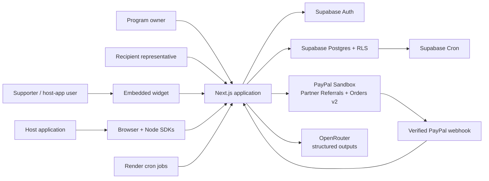

# Our Impact

Our Impact helps a business run community-directed giving campaigns, embed voting and donation experiences in its own product, and turn verified participation into customer entitlements.

The product brings four parties into one auditable workflow:

- **Program owners** create campaigns, commit a budget, review voting results, and approve PayPal funding.
- **Recipients** accept a private invitation, verify their identity, and connect their own PayPal account.
- **Supporters** vote or donate through an embedded campaign without needing an Our Impact account.
- **Developers** connect the host application's user identity, events, entitlements, and webhooks.

> [!IMPORTANT]
> The payment implementation is deliberately **PayPal Sandbox only**. The code does not contain a live PayPal host or a switch that silently moves real money. A program owner explicitly approves each funding checkout, and sandbox success is not evidence that a live charitable-transfer model has been approved.

## What is implemented

- Multi-tenant workspaces protected by Supabase Auth and Postgres Row Level Security.
- Campaign creation, publishing, daily or weekly voting periods, and embedded public widgets.
- Replay-safe voting, deterministic allocation models, immutable allocation snapshots, and a transparent ledger.
- Supabase Cron period closure every five minutes, with a Vercel cron fallback.
- Recipient-owned invitations and PayPal Partner Referrals onboarding.
- PayPal Orders v2 for direct supporter donations and multi-recipient campaign funding.
- Verified PayPal webhooks, idempotent event persistence, and conservative payment reconciliation.
- Developer projects with publishable keys, hashed server keys, short-lived user identity tokens, deterministic entitlements, and signed outbound webhooks.
- Public `@our-impact/browser` and `@our-impact/node` packages.
- OpenAPI 3.0 contracts and an APIMatic-generated Node SDK.
- OpenRouter-backed entitlement proposals and evidence-grounded impact-report drafts, with structured output and human approval.

The durable role, consent, and money-movement boundaries are in [`docs/product-boundaries.md`](docs/product-boundaries.md).

## Architecture at a glance



See [`docs/README.md`](docs/README.md) for the full documentation map and zoomed-in diagrams.

## Prerequisites

- Node.js 24 or newer. The application itself runs on modern Node 20+, but Node 24 also satisfies the APIMatic CLI requirement.
- pnpm 11.25.0 through Corepack.
- A Supabase project, or Docker for the local Supabase stack.
- Optional for payment flows: a PayPal Developer account with Sandbox accounts and Multiparty features.
- Optional for AI features: an OpenRouter API key and a model that supports JSON-schema structured output.
- Optional for SDK generation: APIMatic CLI v2 and an APIMatic account.

## Quick start

1. Clone and install:

   ```bash
   git clone https://github.com/AnsellMaximilian/our-impact.git
   cd our-impact
   corepack enable
   pnpm install
   ```

2. Create a Supabase project, then copy the project URL, publishable key, and secret key from the project's **Connect** / **API Keys** screens.

3. Link the pinned Supabase CLI and apply the schema:

   ```bash
   pnpm exec supabase login
   pnpm exec supabase link --project-ref YOUR_PROJECT_REF
   pnpm exec supabase db push
   ```

4. Copy [`.env.example`](.env.example) to `.env.local` and fill at least the core variables:

   ```bash
   cp .env.example .env.local
   ```

   On PowerShell:

   ```powershell
   Copy-Item .env.example .env.local
   ```

5. In Supabase **Authentication → URL Configuration**, set:

   - Site URL: `http://localhost:3000`
   - Redirect URL: `http://localhost:3000/auth/callback`

6. Start the application:

   ```bash
   pnpm dev
   ```

7. Open [http://localhost:3000](http://localhost:3000), create an account, and create a workspace.

This is the hosted-Supabase path and is the shortest route to a working clone. A fully local Supabase workflow, email testing, PayPal setup, deployment, and troubleshooting are covered in [`docs/setup.md`](docs/setup.md).

## Environment variables

Copy [`.env.example`](.env.example); do not commit the populated file.

| Variable | Required | Where | Purpose |
| --- | --- | --- | --- |
| `NEXT_PUBLIC_SUPABASE_URL` | Yes | Browser + server | Supabase project API URL. |
| `NEXT_PUBLIC_SUPABASE_PUBLISHABLE_KEY` | Yes | Browser + server | RLS-constrained Supabase publishable key. |
| `NEXT_PUBLIC_SITE_URL` | Yes | Browser + server | Canonical application origin used for callbacks and links. |
| `SUPABASE_SECRET_KEY` | Yes | Server only | Privileged database client for trusted routes and workers. |
| `VOTE_HASH_SECRET` | Yes | Server only | HMAC input for privacy-minimized voter and rate-limit identifiers. |
| `CRON_SECRET` | Yes in deployed environments | Server + schedulers | Bearer secret shared by protected cron routes and callers. |
| `DEVELOPER_SIGNING_SECRET` | Yes | Server only | Signs user/widget identity tokens, recipient invitations, and developer webhook secrets. |
| `PAYPAL_SANDBOX_CLIENT_ID` | For PayPal | Server-rendered checkout + server | Sandbox REST application identifier. |
| `PAYPAL_SANDBOX_CLIENT_SECRET` | For PayPal | Server only | Exchanges OAuth client credentials for PayPal access tokens. |
| `PAYPAL_SANDBOX_WEBHOOK_ID` | For PayPal webhooks | Server only | Identifies the registered webhook during signature verification. |
| `PAYPAL_SANDBOX_PARTNER_MERCHANT_ID` | For recipient onboarding | Server only | Merchant ID of the sandbox platform account. |
| `PAYPAL_PARTNER_ATTRIBUTION_ID` | For multiparty PayPal | Server only | PayPal partner attribution / BN code. |
| `OPENROUTER_API_KEY` | For AI features | Server only | Calls OpenRouter Chat Completions. |
| `OPENROUTER_MODEL` | For AI features | Server only | Model slug with structured-output support. |

Generate each application secret independently:

```bash
node -e "console.log(require('node:crypto').randomBytes(32).toString('base64url'))"
```

Run that command separately for `VOTE_HASH_SECRET`, `CRON_SECRET`, and `DEVELOPER_SIGNING_SECRET`. Never reuse a PayPal, Supabase, or OpenRouter credential as an application secret.

## PayPal Sandbox summary

The active payment architecture uses:

- OAuth 2.0 client credentials at `/v1/oauth2/token`.
- Partner Referrals v2 at `/v2/customer/partner-referrals`.
- Merchant integration status at `/v1/customer/partners/{partner_id}/merchant-integrations/{merchant_id}`.
- Orders v2 create and capture at `/v2/checkout/orders` and `/v2/checkout/orders/{id}/capture`.
- PayPal's postback signature verification at `/v1/notifications/verify-webhook-signature`.

Create the webhook at:

```text
https://YOUR_APP_HOST/api/webhooks/paypal
```

Subscribe it to:

- `PAYMENT.CAPTURE.COMPLETED`
- `PAYMENT.CAPTURE.DENIED`
- `PAYMENT.CAPTURE.REFUNDED`
- `PAYMENT.CAPTURE.REVERSED`
- `MERCHANT.ONBOARDING.COMPLETED`
- `MERCHANT.PARTNER-CONSENT.REVOKED`

The older Payouts implementation remains as historical sandbox evidence and has a status-only recovery worker. It is not the primary product payment path. Read [`docs/paypal.md`](docs/paypal.md) before changing payment behavior.

## Database workflow

Migrations are append-only and live in [`supabase/migrations`](supabase/migrations).

```bash
# Apply unapplied migrations to the linked project
pnpm exec supabase db push

# Create a new migration
pnpm exec supabase migration new describe_the_change

# Rebuild the local database from migrations
pnpm exec supabase db reset
```

The repository pins Supabase CLI 2.122.0. Always use `pnpm exec supabase ...` so a global Supabase CLI v3 installation cannot silently change command targeting. Never edit a migration that has already reached a shared environment.

## Developer API and SDKs

- Human-readable integration docs: [https://our-impact.vercel.app/developers/docs](https://our-impact.vercel.app/developers/docs)
- Runtime OpenAPI contract: [https://our-impact.vercel.app/api/openapi](https://our-impact.vercel.app/api/openapi)
- Server SDK: [`@our-impact/node`](https://www.npmjs.com/package/@our-impact/node)
- Browser SDK: [`@our-impact/browser`](https://www.npmjs.com/package/@our-impact/browser)

APIMatic consumes the exported server OpenAPI contract in [`apimatic/server/src/spec/openapi.json`](apimatic/server/src/spec/openapi.json), generates the TypeScript server SDK, validates it, and publishes `@our-impact/node` through an APIMatic publishing profile. The browser SDK is intentionally hand-maintained because widget mounting, iframe resizing, origin coordination, and browser identity are not ordinary OpenAPI operations.

See [`docs/developer-platform.md`](docs/developer-platform.md) for the runtime model and [`docs/publishing.md`](docs/publishing.md) for the release procedure.

## Deployment

The intended test topology is:

- **Vercel** hosts the Next.js application and a daily period-close fallback cron.
- **Supabase** hosts Auth, Postgres, RLS, and the primary five-minute period-close job.
- **Render** calls the legacy PayPal reconciliation and developer webhook-delivery routes every five minutes.
- **PayPal Sandbox** sends payment and onboarding webhooks to the Vercel application.

Use [`render.yaml`](render.yaml) to create the Render cron jobs. Render needs the same `CRON_SECRET` as Vercel; it does not need Supabase, PayPal, or OpenRouter credentials.

Full environment placement, callback URLs, and post-deploy checks are in [`docs/setup.md`](docs/setup.md) and [`docs/operations.md`](docs/operations.md).

## Quality checks

```bash
pnpm test
pnpm lint
pnpm typecheck
pnpm build
pnpm openapi:export
pnpm sdk:check
```

`pnpm openapi:export` intentionally updates generated OpenAPI snapshots. Review those diffs before committing them.

## Documentation

- [Documentation map](docs/README.md)
- [Architecture and technology map](docs/architecture.md)
- [Clone, credentials, and deployment setup](docs/setup.md)
- [PayPal integration](docs/paypal.md)
- [Developer API, identity, entitlements, and SDKs](docs/developer-platform.md)
- [Data model, authentication, and security](docs/data-security.md)
- [Schedulers, webhooks, and operations](docs/operations.md)
- [Product boundaries](docs/product-boundaries.md)
- [SDK publishing](docs/publishing.md)

The original PRD used the working name **ImpactLoop**. The product, packages, documentation, and UI now use **Our Impact**. The PRD remains a living guide; the implementation and these boundary documents are the more precise record of current behavior.
