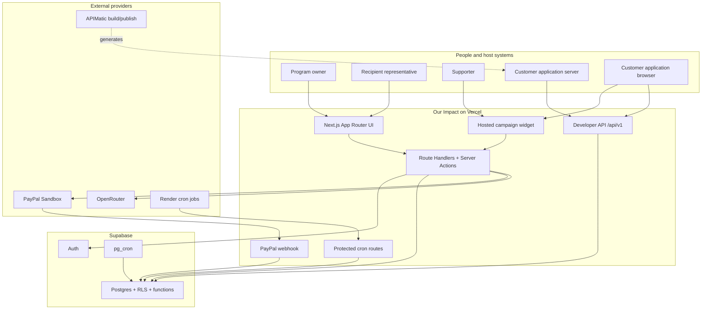

# Our Impact internal documentation

This directory is the engineering record for the current Our Impact implementation. The original PRD is intentionally a living product guide; these documents describe the code, trust boundaries, runtime dependencies, and operational procedures that exist now.

## Reading order

| Document | Use it when |
| --- | --- |
| [Architecture and technology map](architecture.md) | You need the complete system picture, component ownership, request flows, or repository map. |
| [Setup and credentials](setup.md) | You are cloning the repository, creating external accounts, configuring environment variables, or deploying a new environment. |
| [PayPal integration](paypal.md) | You are changing recipient onboarding, checkout, webhook processing, refunds/reversals, or payment state. |
| [Developer platform](developer-platform.md) | You are changing API authentication, identity tokens, events, entitlements, SDKs, OpenAPI, APIMatic, or outbound webhooks. |
| [Data, authentication, and security](data-security.md) | You need the Postgres domain model, RLS model, Supabase authentication flow, credential handling, or security invariants. |
| [Operations](operations.md) | You are investigating schedules, background work, retries, deployment health, logs, or recovery procedures. |
| [Product boundaries](product-boundaries.md) | You need the durable business roles, consent model, or money-movement limits. |
| [SDK publishing](publishing.md) | You are releasing `@our-impact/node` or `@our-impact/browser`. |

## Source-of-truth order

When documents and behavior disagree, resolve the difference in this order:

1. Applied Postgres migrations in `supabase/migrations` for data, constraints, functions, grants, and schedules.
2. Runtime code in `src` for request behavior and external API calls.
3. `src/lib/developer/openapi.ts` for the public developer HTTP contract.
4. This documentation.
5. Historical PRD wording and stage labels.

Then update the lower-level source so the discrepancy does not remain.

## System map

## Architectural principles

- **Allocation is evidence, not authorization.** Closing a period freezes what the vote calculated. It does not charge anyone.
- **The payer approves a payment in PayPal.** A schedule never becomes payment consent.
- **Recipients own their PayPal connection.** Program owners can see readiness but cannot access a recipient's PayPal credentials.
- **Immutable evidence is append-only.** Allocation snapshots, source events, entitlement events, webhook deliveries, payment events, and audit events are preserved rather than rewritten.
- **Every replayable boundary has an idempotency key.** Votes, provider events, developer events, allocations, funding reservations, and deliveries have uniqueness constraints or state claims.
- **Money uses integer minor units.** Display formatting is deferred until the edge; allocation math never depends on floating-point currency values.
- **Public and privileged database access are separate.** RLS handles user-scoped Supabase requests; narrowly scoped server routes use the Supabase secret key.
- **AI proposes; deterministic code decides.** AI output is schema-validated and owner-approved. Entitlement evaluation and payment state are database logic, not model judgment.
- **Sandbox is not production.** Every PayPal path currently targets `api-m.sandbox.paypal.com` and developer keys use a `_test_` prefix.

## Keeping these documents current

Update the relevant document in the same change when you:

- add or remove an environment variable;
- change an external API endpoint, webhook event, or callback URL;
- add a table, database function, RLS policy, trigger, or cron schedule;
- change an API authentication scheme or token claim;
- change retry, reconciliation, or terminal-state behavior;
- change SDK generation or publication;
- introduce a live payment environment.

Mermaid diagrams are kept inline so they render on GitHub and change in the same review as the implementation. Prefer a small, focused diagram over a screenshot of architecture that cannot be diffed.
