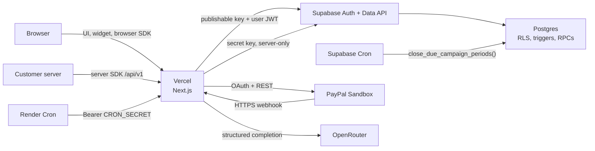
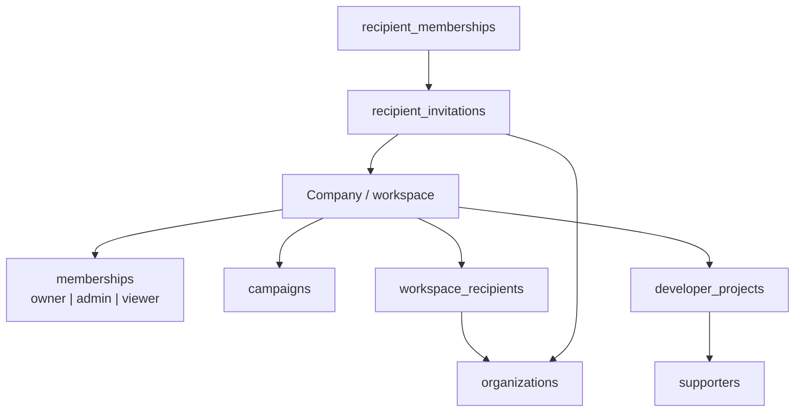
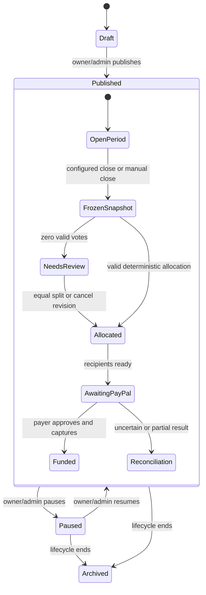
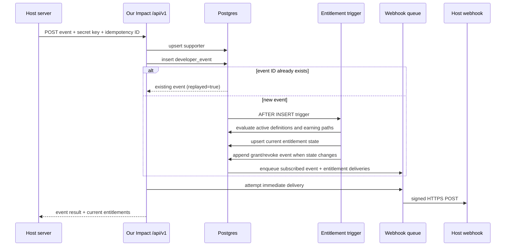

# Architecture and technology map

This document explains how the Our Impact application is assembled and which component owns each decision. It is implementation-oriented: product and compliance boundaries remain in [product-boundaries.md](product-boundaries.md).

## Technology inventory

| Layer | Technology | Responsibility |
| --- | --- | --- |
| Web application | Next.js 16 App Router, React 19, TypeScript | Server-rendered UI, Server Actions, public widget, Route Handlers, cron endpoints, and the developer API. |
| Styling | Tailwind CSS 4, custom CSS, Lucide React | Responsive dashboard, sheets, dialogs, campaign widget, and iconography. |
| Input contracts | Zod 4 | Form, route body, external response, and AI response validation. |
| Authentication | Supabase Auth + `@supabase/ssr` | Email/password and email OTP sessions stored in cookies and refreshed by the Next.js proxy. |
| Database | Supabase Postgres 17 | Tenant data, campaign state, immutable ledgers, PayPal state, developer identity, entitlements, and webhook queues. |
| Authorization | Postgres RLS, grants, constraints, security-definer functions | Workspace isolation and atomic business rules. |
| Scheduling | Supabase Cron / `pg_cron`, Vercel Cron, Render Cron | Period closure, fallback closure, legacy payout reconciliation, and outbound webhook delivery. |
| Payments | PayPal REST APIs and PayPal JavaScript SDK | OAuth, recipient onboarding, merchant status, Orders v2 approval/capture, verified webhooks, and historical Payouts status. |
| AI | OpenRouter Chat Completions | JSON-schema campaign and entitlement proposals plus evidence-grounded report drafts. |
| Developer platform | OpenAPI 3.0, `@our-impact/node`, `@our-impact/browser` | Trusted server events and identity, browser entitlement checks, and campaign embedding. |
| SDK generation | APIMatic CLI and Publishing Center | Validates the server OpenAPI contract, generates TypeScript, and publishes the Node SDK. |
| Test and quality | Vitest, ESLint, TypeScript, APIMatic validation | Unit tests, static analysis, package smoke tests, and API contract validation. |
| Hosting | Vercel, Supabase, Render | Web runtime, managed data/auth, and five-minute external schedulers. |

Exact package versions are pinned in [`package.json`](../package.json) and the package manifests under `packages/`.

## Runtime topology



### Why the application does not use a database URL

The Next.js runtime uses `@supabase/supabase-js` against the Supabase API URL. Browser and user-scoped server requests use the publishable key and the authenticated user's JWT, so RLS remains active. Trusted internal routes create a separate non-persistent client with `SUPABASE_SECRET_KEY`. The application does not open direct Postgres connections.

The Supabase CLI does use the database connection behind the scenes for migrations, but that credential is managed by `supabase link` and is not an application environment variable.

## Application surfaces

### Public surfaces

- `/`: marketing and product entry point.
- `/embed/[publicId]`: responsive campaign widget.
- Public campaign routes for identity, voting, donation order creation, and capture.
- `/developers/docs`: human-readable integration documentation.
- `/api/openapi`: generated OpenAPI document.
- Recipient connection links: signed, private entry points that still require email-authenticated claiming.

### Authenticated program-owner surfaces

- Workspace dashboard.
- Campaign creation and campaign detail tabs.
- Recipient directory and invitation management.
- Developer projects, entitlements, users, credentials, and webhook endpoints.
- AI entitlement assistant and impact-report review.

### Recipient-owned surfaces

- Invitation access and email verification.
- Recipient membership claim.
- Recipient portal.
- PayPal Sandbox connection and status refresh.

### Machine surfaces

- `/api/v1/*` for host application servers and browsers.
- `/api/webhooks/paypal` for PayPal.
- `/api/cron/*` for Vercel and Render.

## Role model



- A **workspace membership** authorizes Our Impact dashboard actions.
- A **recipient membership** authorizes a representative to manage one recipient organization for one workspace relationship.
- A **supporter** is not a Supabase Auth user. It is a project-scoped external identity supplied by the host application.
- A visitor can use a public campaign anonymously; privacy-minimized cookies and hashes enforce basic voting limits. Identified widgets bind activity to a supporter.

## Campaign lifecycle



### Period creation and closure

Campaigns store:

- currency and integer `budget_minor`;
- IANA time zone;
- daily or weekly cadence;
- local close time and weekly close day;
- allocation model.

Publishing creates the initial period. The database computes and stores exact UTC boundaries from campaign-local configuration. `close_due_campaign_periods(100)` scans for due periods and finalizes them under row locks. A uniqueness model prevents a replay from creating a second snapshot.

### Allocation

The database supports:

- `winner_takes_all`;
- `proportional`;
- `hybrid`.

Allocation occurs in integer minor units. Remainder distribution is deterministic, and every valid snapshot must conserve the committed total exactly. A zero-vote period requires an explicit equal-split or cancel revision rather than inventing a winner.

### Ledger terminology

- **Committed**: the amount the program owner promised for a period.
- **Allocated**: the frozen calculation assigning that commitment to recipients.
- **Confirmed**: payment evidence recorded after PayPal capture/webhook processing.
- **Direct supporter donation**: a separate buyer-to-recipient payment; it is never counted as the program owner's committed funding.

Keeping these values separate is a primary product invariant.

## Identity and authentication layers

There are three separate identity systems.

### 1. Our Impact account sessions

Program owners and recipient representatives authenticate with Supabase. The browser receives Supabase session cookies; `src/proxy.ts` calls `auth.getClaims()` to refresh/validate them and propagate updated cookies. Server Actions and Route Handlers use the cookie-aware server client.

### 2. Anonymous widget identity

The public widget uses a privacy-minimized cookie and server-side HMAC hashes for voting and rate limits. It is intentionally a low-assurance baseline and is not a durable customer identity across browsers.

### 3. Host application supporter identity

The host server sends its own external user ID using a secret API key. Our Impact upserts a project-scoped supporter and issues a short-lived HMAC-signed identity token. The browser combines that token with a publishable key. It cannot mint a token or choose another user's external ID by itself.

The three systems must not be collapsed. A supporter does not need an Our Impact login, and a recipient invitation does not authorize access to a program-owner workspace.

## Payment architecture

The active implementation has two Orders v2 use cases:

1. A supporter donates directly to one consented recipient.
2. A program owner approves one order containing a purchase unit for each allocation recipient.

Both use recipient merchant IDs obtained through Partner Referrals. The older Payouts code is retained only for historical test records and recovery behavior. See [paypal.md](paypal.md).

## Developer event and entitlement pipeline



Rules are deterministic Postgres logic. The AI assistant can propose a definition or an additional earning path, but the proposal must be reviewed and applied before it participates in this pipeline.

## AI boundaries

OpenRouter is called only from server code. All AI features request a JSON-schema response and parse it with Zod:

- **Campaign assistant** receives the active workspace recipient catalog and the owner's conversation. It can ask follow-up questions or propose every field required by the existing draft-campaign function. Approval creates only a private draft; publishing and funding remain separate owner actions.
- **Impact reports** receive an allowlisted source catalog derived from frozen campaign evidence. Generated citations are checked against that catalog before storage. Approval is a separate human action and does not publish or move money.
- **Entitlement assistant** receives the existing project catalog and the user's conversation. It can ask a clarifying question or return a proposed deterministic change. It cannot grant an entitlement directly.

If OpenRouter is absent, the rest of the application still works. The relevant UI reports that AI is not configured.

## Deployment responsibilities

| Component | Owns | Does not own |
| --- | --- | --- |
| Vercel | Next.js runtime, UI, APIs, PayPal webhook, fallback close cron | Primary five-minute period scheduling |
| Supabase | Auth, database, RLS, functions, triggers, primary period cron | PayPal API credentials |
| Render | Calls two protected recovery/delivery routes every five minutes | Business logic or provider credentials |
| PayPal Sandbox | Seller consent, payer approval, payment processing, provider events | Our Impact entitlement logic |
| OpenRouter | Structured model completion | Applying rules or publishing reports |
| APIMatic | Contract validation, Node SDK generation/publication, optional portal | Runtime API behavior or browser widget implementation |

## Repository map

```text
our-impact/
├── src/
│   ├── app/
│   │   ├── (auth)/                 Supabase login and signup
│   │   ├── api/                    Developer, PayPal, campaign, and cron routes
│   │   ├── dashboard/              Program-owner application
│   │   ├── developers/docs/        Public developer documentation
│   │   ├── embed/[publicId]/       Hosted widget
│   │   └── recipients/             Invitation and recipient portal
│   ├── components/                 Shared UI and interactive workspaces
│   └── lib/
│       ├── ai/                     Structured OpenRouter prompts and validation
│       ├── developer/              API auth, tokens, events, OpenAPI, webhooks
│       ├── paypal/                 Sandbox OAuth, Partner, Orders, Payouts
│       └── supabase/               Browser, SSR, public, proxy, privileged clients
├── supabase/
│   ├── migrations/                 Append-only schema and behavior history
│   ├── config.toml                 Local Supabase configuration
│   └── seed.sql                    Explicit no-op local seed
├── packages/
│   ├── browser/                    Hand-maintained browser SDK
│   └── node/                       APIMatic-generated server SDK
├── apimatic/
│   ├── src/                        Full portal source and public OpenAPI
│   └── server/src/                 Server-only SDK contract
├── scripts/                        Contract export, package smoke, cron callers
├── examples/mikes-vegan-shop/      End-to-end external integration example
├── demo-site/                      Standalone static widget demo
├── docs/                           Internal engineering documentation
├── render.yaml                     Render cron blueprint
└── vercel.json                     Vercel fallback cron
```

## Change guide

| Change | Start with | Also inspect |
| --- | --- | --- |
| Campaign or allocation behavior | latest campaign migration/function | dashboard actions, widget, period tests |
| Supabase authentication | `src/lib/supabase/*` and `src/proxy.ts` | auth actions/callback, current Supabase SSR guide |
| Recipient onboarding | `src/app/recipients/*` | recipient migration, PayPal onboarding routes |
| PayPal request/response | `src/lib/paypal/*` | routes, webhook SQL functions, official PayPal docs |
| Entitlement evaluation | latest `private.evaluate_developer_entitlements` migration | developer API, assistant actions, SDK models |
| Public API | route + `src/lib/developer/openapi.ts` | exported snapshots, Node SDK, web docs |
| Background work | protected route + claiming SQL function | `render.yaml`, `vercel.json`, logs |
| Environment variable | consuming module | `.env.example`, README, setup and deployment tables |

Do not infer current behavior from an early stage migration alone. Later migrations replace several functions and add constraints without deleting the historical file.
