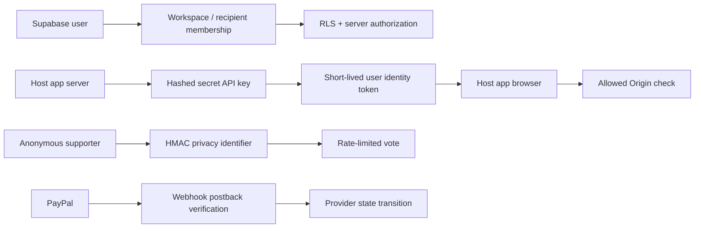
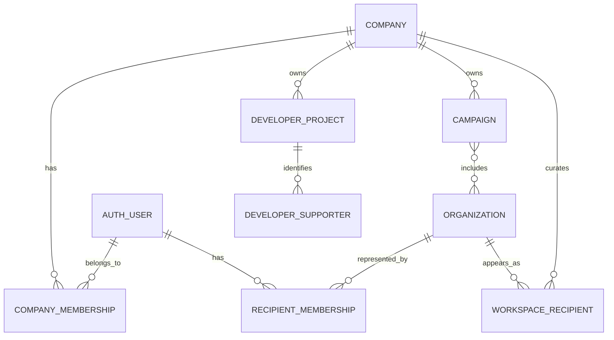
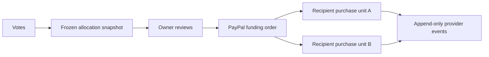

# Data, authentication, and security

This document describes the persisted domains, identity systems, authorization boundaries, and security invariants in Our Impact. It is an implementation guide, not a substitute for a production security review.

## Trust model

Our Impact has four human roles and several machine identities:

| Actor | Primary identity | Trusted for |
| --- | --- | --- |
| Program owner or workspace teammate | Supabase Auth user plus company membership | Workspace administration, campaigns, developer projects, and explicit funding approval. |
| Recipient representative | Supabase Auth user plus recipient membership | The invited recipient profile and its PayPal onboarding connection. |
| Supporter | Host application's external user ID, optionally bound by a short-lived Our Impact identity token | Voting, direct donation attribution, and host-product entitlement lookup. |
| Anonymous widget visitor | Privacy-minimized browser and network signals | Public campaign viewing and a rate-limited vote, never a host-product entitlement identity. |
| Customer application server | Our Impact secret API key | Creating identity tokens, ingesting verified events, and reading its own users' entitlements. |
| Customer application browser | Publishable key, allowed Origin, and short-lived identity token | Reading only the current bound user's entitlements and mounting approved embeds. |
| Scheduler | Shared `CRON_SECRET` bearer token | Calling a small set of protected maintenance routes. |
| PayPal | Verified webhook signature | Advancing provider-owned payment and merchant-connection state. |



## Supabase authentication

### Browser and server clients

The application uses `@supabase/ssr`:

- the browser client uses the public Supabase URL and publishable key;
- the server client reads and writes auth cookies through the request boundary;
- `src/proxy.ts` refreshes and validates the cookie-backed session with `auth.getClaims()`;
- sensitive server routes use `auth.getUser()` before authorizing a user-owned operation.

Create a new Supabase client per request. Do not place authenticated responses into a shared cache or static regeneration path. A cached response could cross user boundaries.

### Sign-up and sign-in

The primary account flow is email and password:

1. The browser submits the credentials to a server action.
2. Supabase creates or verifies the Auth user.
3. Email confirmation returns to `/auth/callback`.
4. The callback exchanges the PKCE authorization code for a cookie-backed session.
5. Workspace membership determines which product data the user can access.

Application password validation requires at least eight characters and a letter, number, and symbol. Supabase remains the credential store; the application does not persist password hashes.

### Recipient invitations

Recipient access intentionally adds a second proof beyond ordinary sign-in:

1. A program owner creates an invitation for a specific recipient and email address.
2. The application signs the invitation token with `DEVELOPER_SIGNING_SECRET` using a recipient-invitation context.
3. The representative authenticates through Supabase, normally by email OTP/magic link.
4. The signed invitation is validated for recipient, email, expiry, and acceptance state.
5. The authenticated email must exactly match the invitation email.
6. Acceptance creates recipient membership.
7. Only that recipient member may begin or inspect its PayPal onboarding.

Signing the invitation prevents a user from changing the recipient ID or invited email in the URL. Supabase authentication proves control of the invited account. Both checks are required.

> PayPal Sandbox login during seller onboarding is a separate provider session. It does not authenticate the person into Our Impact.

## Database access paths

There are three database access modes:

| Mode | Credential | Enforcement |
| --- | --- | --- |
| Browser and ordinary signed-in requests | Supabase publishable key plus user JWT | Postgres RLS and SQL grants. |
| Trusted application routes and workers | `SUPABASE_SECRET_KEY` | Application authorization plus database constraints; bypasses ordinary RLS and must stay narrowly scoped. |
| Database-local jobs | Postgres function owner / scheduled execution context | Function grants, fixed SQL logic, and constraints. |

The secret client is never bundled into browser code. A route using it must first establish why the caller is authorized, constrain every query by the relevant company, project, campaign, or recipient, and avoid returning privileged rows wholesale.

## Tenant hierarchy



Important consequences:

- a company owns campaigns and developer projects;
- an organization is the canonical recipient identity;
- a workspace recipient is that company's curated relationship with an organization;
- a recipient representative is scoped to the organization, not automatically to every company that curates it;
- campaigns and developer projects are siblings under a company, not permanently linked one-to-one;
- a widget identity token creates the temporary bridge among a project supporter, a campaign session, and an allowed parent origin.

## Persisted domains

The schema evolved through append-only files in `supabase/migrations`. Later migrations may replace earlier function definitions; inspect the latest definition before modifying behavior.

### Accounts and workspaces

This domain contains:

- application profiles corresponding to Supabase Auth users;
- companies/workspaces;
- company memberships and roles;
- organization records;
- workspace recipient relationships;
- recipient invitations and recipient memberships.

Authorization is membership-based. A foreign key alone does not grant visibility; the RLS policy or trusted route must also establish membership.

### Campaigns and voting

This domain contains:

- campaigns and campaign-recipient membership;
- repeating campaign periods;
- votes;
- immutable allocation snapshots and allocation lines;
- audit events;
- impact-report drafts.

Period closure is a database transaction. It claims a due period, freezes the evidence and allocation revision, and advances the schedule without treating the allocation as permission to charge the owner.

Vote protections include:

- campaign and period state checks;
- one-way HMAC identifiers derived from privacy-minimized request signals;
- replay/rate-limit constraints;
- database uniqueness and function-level validation;
- no dependency on a supporter having an Our Impact account.

### PayPal and money

This domain contains:

- recipient PayPal merchant connections and onboarding state;
- direct-donation sessions and provider order events;
- campaign funding orders and per-recipient funding units;
- provider payment status events;
- legacy payout transaction and event records.

Store currency amounts as integer minor units whenever the schema represents arithmetic. Provider IDs, idempotency keys, and raw status history are retained so a final state can be reconstructed without guessing from the UI.

An allocation snapshot and a funding order are deliberately separate records:



### Developer platform

This domain contains:

- developer projects;
- allowed browser origins;
- publishable and secret API-key records;
- supporters keyed by project plus external user ID;
- developer events with source idempotency IDs;
- entitlement definitions and earning paths;
- current user entitlements and append-only grant/revoke events;
- outbound webhook endpoints and delivery attempts;
- entitlement-assistant proposal runs.

The database trigger evaluates deterministic entitlement rules after a developer event is accepted. It also records grant/revoke evidence and queues outbound events. The AI assistant never writes an entitlement directly around that mechanism.

## Row Level Security

RLS is a defense boundary, not a substitute for application validation.

The intended pattern is:

1. public tables expose only the rows needed for a public campaign/widget read;
2. signed-in workspace users see rows reachable through their company membership;
3. recipient representatives see only recipient-scoped records reachable through recipient membership;
4. write policies require the appropriate owner/administrator relationship;
5. trusted service routes use the secret client only when RLS cannot express the external-provider workflow safely;
6. SQL functions expose the smallest operation needed and have explicit execution grants.

When adding a table:

- enable RLS immediately;
- add policies for every intended role and no broad fallback;
- add tenant columns and foreign keys before exposing the table;
- index columns used by both the policy and common query;
- test a user from another workspace, not only the happy path;
- test anonymous access explicitly;
- review grants on functions as well as tables.

## Application credentials

### Supabase keys

- `NEXT_PUBLIC_SUPABASE_PUBLISHABLE_KEY` is expected in browser code and is safe only because RLS restricts it.
- `SUPABASE_SECRET_KEY` is privileged and server-only.
- Never use the secret key to solve an RLS error in browser code.

### Developer API keys

Developer projects receive two key types:

- publishable keys use an `oi_pk_test_` prefix and may be embedded in an allowed website;
- secret keys use an `oi_sk_test_` prefix and are shown only when created or rotated.

Only the secret-key hash and a display fingerprint are stored. Authentication hashes the presented key and uses a timing-safe comparison. Rotation creates a new credential and revokes the superseded credential; key history is operational evidence, not reusable plaintext.

### Identity tokens

The customer application server exchanges its secret key and an authenticated external user ID for a signed identity token.

The token binds:

- token type and schema version;
- developer project;
- company;
- developer supporter;
- external user ID;
- optional campaign;
- intended parent origin;
- issued-at and expiry.

TTL is constrained to 60–3,600 seconds and defaults to 15 minutes. The host server must derive the external user ID from its own authenticated session, never accept an arbitrary user ID from an untrusted browser request.

### Widget session

An identified widget validates the publishable key, identity token, campaign, and parent Origin together. The production cookie uses the `__Host-` prefix, which requires a secure, host-only, path-root cookie. The browser package also validates `postMessage` origin and source before accepting resize or lifecycle messages.

### Application HMAC secrets

Generate independent random values for:

- `VOTE_HASH_SECRET` — privacy-minimized vote and rate-limit identifiers;
- `CRON_SECRET` — scheduler bearer authorization;
- `DEVELOPER_SIGNING_SECRET` — identity tokens, recipient invitations, and derived developer-webhook secrets.

Do not reuse provider secrets. Context strings, token types, versions, endpoint IDs, and signed payload formats provide domain separation inside the signing implementation.

## Webhook security

### PayPal inbound webhooks

The handler:

1. reads and size-limits the raw request body;
2. parses the JSON envelope only after retaining the original bytes;
3. collects PayPal transmission headers;
4. sends those headers, the registered webhook ID, and event to PayPal's postback verification endpoint;
5. processes the event only when PayPal returns `SUCCESS`;
6. deduplicates the provider event ID;
7. appends status evidence before projecting current state;
8. returns a non-2xx response when the delivery should be retried.

Do not replace provider verification with a simple shared-secret comparison. See [paypal.md](paypal.md).

### Developer outbound webhooks

Each endpoint has a derived secret. A delivery signs:

```text
{unix_timestamp}.{raw_json_body}
```

The receiver must:

1. read the raw body;
2. reject a timestamp outside its tolerance;
3. recompute HMAC SHA-256 with the endpoint secret;
4. compare signatures in constant time;
5. deduplicate the delivery ID;
6. return 2xx only after it has durably accepted the event.

Endpoint URLs must be HTTPS and pass basic SSRF screening. This is defense in depth; a production launch should also consider DNS rebinding, redirect behavior, resolved-address checks, and outbound network controls.

## Data minimization and privacy

- Our Impact does not store program-owner or recipient PayPal passwords.
- It does not receive supporter card details; PayPal owns payment credential entry.
- The developer platform stores the host application's external user ID, not the host user's password.
- Anonymous voting uses one-way HMAC identifiers instead of persisting raw network identifiers as the product identity.
- Recipient invitation emails are stored only where required to authorize and audit the invitation.
- Raw provider payload retention should be reviewed before live use for data classification, regional retention, and deletion requirements.

## AI safety boundary

OpenRouter receives only the content assembled for a specific feature:

- the campaign assistant receives active workspace recipient descriptions and the owner's conversation and returns a schema-constrained private-draft proposal or clarification;
- the entitlement assistant receives the project catalog and the owner's instruction and returns schema-constrained proposals or clarification;
- the impact-report feature receives an allowlisted frozen evidence bundle and must cite that bundle.

The server validates structured output and references before saving a draft. The model cannot:

- grant or revoke an entitlement directly;
- publish or fund a campaign;
- manufacture a payment state;
- change an allocation snapshot;
- bypass owner approval;
- read unrestricted database rows.

## Security-sensitive change checklist

- [ ] Identify every caller and the credential it presents.
- [ ] Decide whether RLS or a trusted route owns authorization.
- [ ] Scope every privileged query by tenant and resource.
- [ ] Add idempotency for any replayable request.
- [ ] Preserve raw evidence before updating projected state.
- [ ] Keep money in integer minor units.
- [ ] Validate callback and webhook URLs against the expected origin/environment.
- [ ] Do not log access tokens, secrets, full authorization headers, or payment credentials.
- [ ] Test a cross-tenant user, an unauthenticated user, an expired token, and a replay.
- [ ] Document new environment variables, provider events, SQL functions, and operational recovery.

## Known pre-production work

Before presenting the system as production-ready:

- replace the sandbox-only PayPal configuration with an explicit, reviewed live-environment design;
- complete PayPal partner/live approval and legal/compliance review;
- design secret rotation without relying on a single shared root forever;
- add managed secret storage and access auditing for every deployment;
- define data retention, erasure, and export policies;
- add formal threat modeling and penetration testing;
- add alerting for webhook verification failures, cross-tenant authorization failures, and repeated key misuse;
- review all `SECURITY DEFINER` functions, grants, RLS policies, and dependency advisories.
