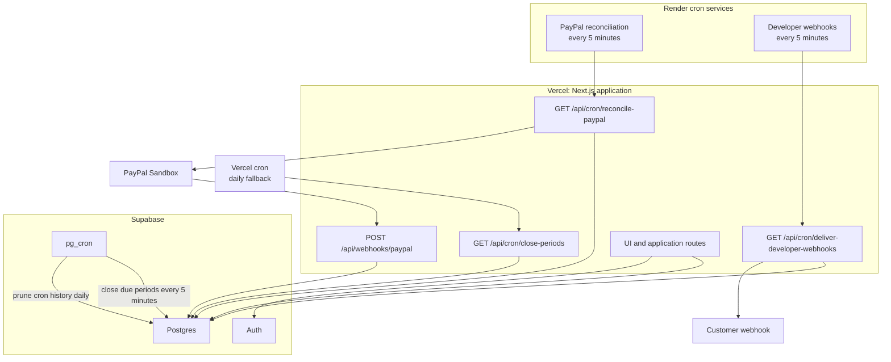
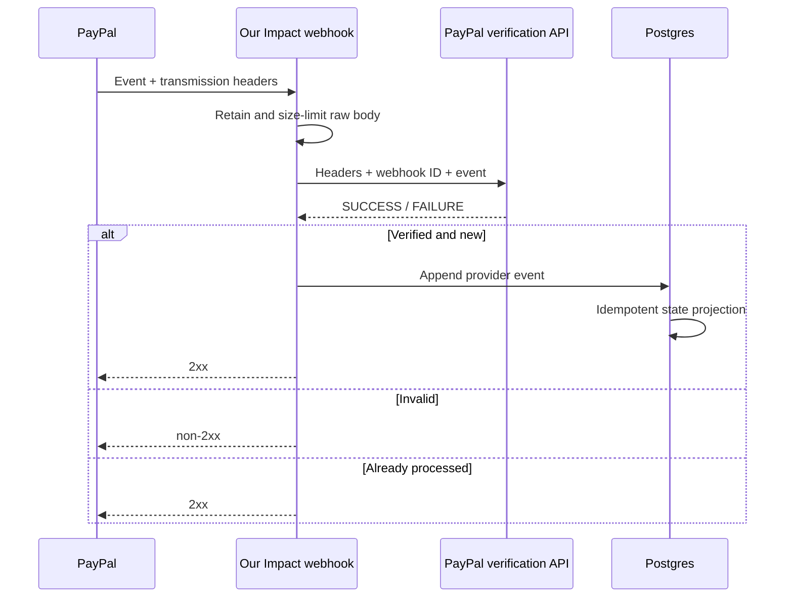

# Schedulers, webhooks, and operations

This runbook explains which background systems exist, why more than one scheduler appears in the project, how retries work, and how to diagnose a stalled campaign, payment, or developer webhook.

## Runtime topology



## Why there are multiple schedulers

The jobs have different responsibilities:

| Owner | Schedule | Operation | Why it lives there |
| --- | --- | --- | --- |
| Supabase `pg_cron` | Every 5 minutes | `close_due_campaign_periods(100)` | Period closure is database-local, transactional work and does not require an HTTP provider. This is the primary closer. |
| Supabase `pg_cron` | Daily at 02:15 | Delete `cron.job_run_details` older than 14 days | `pg_cron` does not prune its own history. |
| Vercel cron | Daily at 13:00 UTC | `GET /api/cron/close-periods` | Coarse fallback for period closure if the database schedule is unavailable. |
| Render cron | Every 5 minutes | `GET /api/cron/reconcile-paypal` | Calls PayPal for the status of unresolved **legacy Payouts** transactions. |
| Render cron | Every 5 minutes | `GET /api/cron/deliver-developer-webhooks` | Retries queued outbound events when an immediate delivery did not finish. |

Do not add a scheduler that automatically approves or captures a campaign funding payment. A schedule determines when work is due; it does not grant payer consent.

## Cron authorization

All three HTTP cron routes use the same `CRON_SECRET` and expect:

```http
Authorization: Bearer YOUR_CRON_SECRET
```

The value must be identical in:

- Vercel environment variables;
- Render's PayPal reconciliation service;
- Render's developer webhook service.

The route returns `401` when the header is missing or wrong and `503` or `500` when the operation itself cannot run. Do not put `CRON_SECRET` in a public URL or browser bundle.

### Manual invocation

Manual calls are useful after configuration changes:

```bash
curl \
  -H "Authorization: Bearer $CRON_SECRET" \
  https://YOUR_APP_HOST/api/cron/close-periods

curl \
  -H "Authorization: Bearer $CRON_SECRET" \
  https://YOUR_APP_HOST/api/cron/reconcile-paypal

curl \
  -H "Authorization: Bearer $CRON_SECRET" \
  https://YOUR_APP_HOST/api/cron/deliver-developer-webhooks
```

Treat returned JSON as a work summary, not as payment evidence. Provider and database event records are the durable evidence.

## Campaign period closure

### Primary path

The database schedule runs:

```sql
select public.close_due_campaign_periods(100);
```

The function claims at most 100 due periods per execution. The close transaction freezes the vote evidence, applies the configured allocation model, creates or revises the immutable snapshot, and advances the campaign schedule.

### Fallback path

The Vercel route calls the same function with the same batch limit. Because the database operation owns claiming and uniqueness, overlapping invocations should be replay-safe rather than create a second allocation.

### Expectations

- A period ending at 13:30 does not need to wait until the next day's Vercel cron while Supabase `pg_cron` is healthy; it should be eligible within roughly five minutes.
- The daily Vercel schedule is fallback coverage, not the target latency.
- Closure can create an allocation that needs review, including a no-valid-votes state.
- Closure does not create or capture a PayPal order.

### Diagnose a period that did not close

1. Confirm the campaign is published and the period close time has passed in UTC.
2. Inspect `cron.job` for `our-impact-close-due-periods`.
3. Inspect recent `cron.job_run_details` for errors.
4. Call the protected Vercel close route manually.
5. Check Vercel logs for `Stage 2 period close failed` or configuration errors.
6. Inspect the latest definition of `close_due_campaign_periods` in migrations before assuming an older function signature.
7. Check for a review state rather than assuming “not funded” means “not closed.”

Useful read-only SQL:

```sql
select jobid, jobname, schedule, active
from cron.job
where jobname like 'our-impact-%'
order by jobname;

select jobid, status, start_time, end_time, return_message
from cron.job_run_details
order by start_time desc
limit 50;
```

## PayPal inbound webhook

Endpoint:

```text
POST https://YOUR_APP_HOST/api/webhooks/paypal
```

### Delivery path



The body limit is 1 MB. The event ID is deduplicated. The handler supports capture completion, denial, refund, reversal, merchant onboarding completion, and partner-consent revocation. Legacy Payouts notifications are routed to the retained legacy state path.

PayPal retries webhook deliveries that do not receive a successful HTTP response. Its current REST webhook documentation describes up to 25 retries over three days, so the endpoint must remain idempotent.

### Diagnose a missing PayPal event

1. Open the PayPal Developer webhook event log for the correct sandbox REST application.
2. Confirm the webhook URL exactly matches the deployed host and uses HTTPS.
3. Confirm the event is subscribed and the delivery status is not pending or failed.
4. Confirm `PAYPAL_SANDBOX_WEBHOOK_ID` is the ID of that exact webhook, not the app or event ID.
5. Check Vercel logs for signature-verification or persistence errors.
6. Resend the event from PayPal only after confirming idempotency.
7. Inspect the provider event/status tables; a UI projection can lag or show a summarized status.
8. If onboarding completed but readiness remains false, recheck merchant integration status; “can receive payments” alone is not the full readiness predicate.

Never mark a transaction complete merely because the browser returned to a success URL. Browser callbacks are user experience; capture response and verified provider events are evidence.

## Campaign funding operations

Campaign funding uses PayPal Orders v2 multi-seller purchase units. The owner explicitly reviews and approves the checkout.

Operational states exist at two levels:

- the funding order summarizes the overall attempt;
- each funding unit records the recipient-specific purchase unit and capture result.

Because multiple captures can produce a mixed outcome, the capture route can return HTTP `207 Multi-Status`. Do not flatten a partially successful funding order into a single boolean. Reconciliation, support tooling, and UI must preserve which recipient succeeded.

When investigating:

1. find the local funding order;
2. correlate its PayPal order ID;
3. inspect every funding unit;
4. inspect appended provider status events;
5. compare the PayPal debug ID from any failed API call;
6. verify recipient merchant readiness and currency;
7. do not retry a successful unit by constructing a new uncorrelated order.

## Legacy PayPal Payouts reconciliation

The Payouts implementation is retained as historical sandbox evidence. The Render job is deliberately **status-only**:

1. claim up to ten due reconciliation records with a 120-second lease;
2. query `GET /v1/payments/payouts/{batch_id}`;
3. record batch and item state;
4. schedule another lookup if the provider state is not terminal.

It never creates a payout and never retries a failed money-movement request.

Error backoff in the database is:

- first attempts: five minutes;
- intermediate attempts: fifteen minutes;
- later attempts: one hour.

If the job fails before contacting PayPal, verify `RECONCILIATION_URL`, `CRON_SECRET`, and HTTPS in Render. If it reaches Vercel but returns `503`, verify the PayPal client ID/secret and Supabase privileged configuration in Vercel.

## Developer webhook delivery

### Queue and immediate attempt

When a developer event or entitlement transition queues an outbound event, the application can attempt immediate delivery. The durable delivery row remains the source of retry state.

The Render worker calls the delivery route every five minutes. The route claims up to 50 eligible deliveries, posts each with an eight-second timeout, and records the result.

### Signature headers

Receivers use:

- `our-impact-event` — event type;
- `our-impact-delivery` — unique delivery ID;
- `our-impact-signature` — timestamped HMAC signature.

See [developer-platform.md](developer-platform.md) for verification pseudocode and payload semantics.

### Retry policy

After a failed attempt:

```text
delay minutes = min(2 ^ attempt_count, 60)
```

A delivery becomes terminal `failed` after six attempts. A 2xx response marks it delivered. Redirects, timeouts, connection failures, and non-2xx responses must not be treated as success.

### Diagnose a failed endpoint

1. Confirm the endpoint is active and HTTPS.
2. Confirm the receiver reads the raw body before JSON reserialization.
3. Confirm it verifies the endpoint's own signing secret, not `DEVELOPER_SIGNING_SECRET`.
4. Confirm its server clock is synchronized.
5. Look at the last HTTP status/error and attempt count.
6. Confirm the endpoint can respond inside eight seconds; queue long work on the receiver side.
7. Confirm it returns 2xx only after durable acceptance.
8. Replay only with the same delivery/event identifiers and ensure the receiver deduplicates them.

## Observability by system

| Question | First place to look | Correlation value |
| --- | --- | --- |
| Did a request reach the application? | Vercel function logs | Route, timestamp, local record ID. |
| Did a database cron execute? | Supabase `cron.job_run_details` | Job ID/name and start time. |
| Did PayPal accept/reject an API request? | Vercel structured error plus PayPal event log | PayPal `debug_id` and order/capture/batch ID. |
| Did PayPal send a webhook? | PayPal Developer webhook log | PayPal webhook event ID. |
| Did a developer endpoint receive an event? | Webhook delivery row and customer logs | `our-impact-delivery` and developer event ID. |
| Did an entitlement change? | User entitlement event history | Developer event ID, entitlement definition ID. |
| Did a Render cron run? | Render job log | Job timestamp and returned JSON summary. |

Logs should contain stable IDs and bounded error codes, never secrets, complete authorization headers, PayPal access tokens, or customer payment details.

## Deployment and configuration checks

### Vercel

Required:

- all core Supabase variables;
- all application HMAC secrets;
- PayPal variables when testing payments;
- OpenRouter variables when testing AI;
- `NEXT_PUBLIC_SITE_URL` set to the deployed canonical origin.

After changing variables, redeploy. Existing deployments do not necessarily receive newly added values.

### Render

PayPal reconciliation service:

- `RECONCILIATION_URL=https://YOUR_APP_HOST/api/cron/reconcile-paypal`
- `CRON_SECRET` matching Vercel.

Developer webhook service:

- `DEVELOPER_WEBHOOK_URL=https://YOUR_APP_HOST/api/cron/deliver-developer-webhooks`
- `CRON_SECRET` matching Vercel.

Render does not need the database or PayPal credentials because it only invokes protected application routes.

### Supabase

- migrations applied;
- `pg_cron` extension and jobs present;
- Auth Site URL and redirect allowlist match the environment;
- secret/publishable keys come from the same project;
- outbound email provider configured before relying on production recipient invitations.

### PayPal

- correct sandbox REST application;
- Multiparty/seller onboarding feature available;
- partner merchant ID and BN code correspond to the integration;
- webhook ID belongs to the deployed webhook;
- subscribed event list matches [paypal.md](paypal.md);
- recipient accounts are sandbox business accounts and complete readiness checks.

## Recovery principles

- Prefer a replay of an idempotent command over a manual row edit.
- Preserve the failed attempt and append the corrective event.
- Do not delete allocation, payment, entitlement, or webhook evidence to make a UI look clean.
- Do not change a provider-complete payment back to pending without a compensating provider event.
- Do not re-run money movement from a scheduler.
- Use SQL mutation only when an application/provider replay cannot express the recovery, and record the reason in an audit event.

## Incident triage checklist

1. State the affected environment, workspace, campaign/project, and time window.
2. Determine whether the problem is presentation, authorization, database state, scheduler execution, or an external provider.
3. Capture local IDs and external correlation/debug IDs before retrying.
4. Check whether the operation is safe to replay.
5. Verify secrets by presence and fingerprint, never by printing them.
6. Restore service using the narrowest idempotent action.
7. Confirm downstream projections and webhooks caught up.
8. Record the root cause and update this runbook if the recovery was not already documented.

## Routine maintenance

- Review failed developer webhook deliveries and stale PayPal states.
- Review Supabase cron failures and job-history growth.
- Rotate application, provider, and developer credentials on a defined schedule.
- Apply dependency and platform security updates.
- Run `pnpm test`, `pnpm lint`, `pnpm typecheck`, and `pnpm build` before deployment.
- Export and review OpenAPI whenever the public API changes.
- Test recipient onboarding, one direct donation, one funding checkout, and one entitlement transition after provider configuration changes.
- Keep the sandbox/live boundary explicit; never repoint the current sandbox client through an environment variable without a reviewed live-state model.
