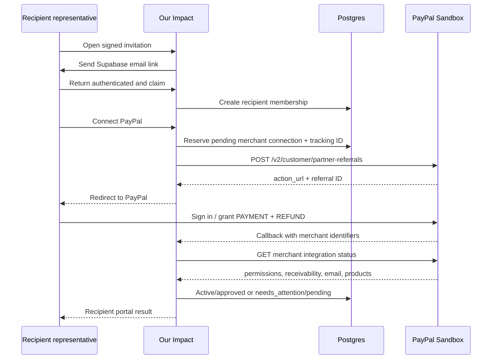
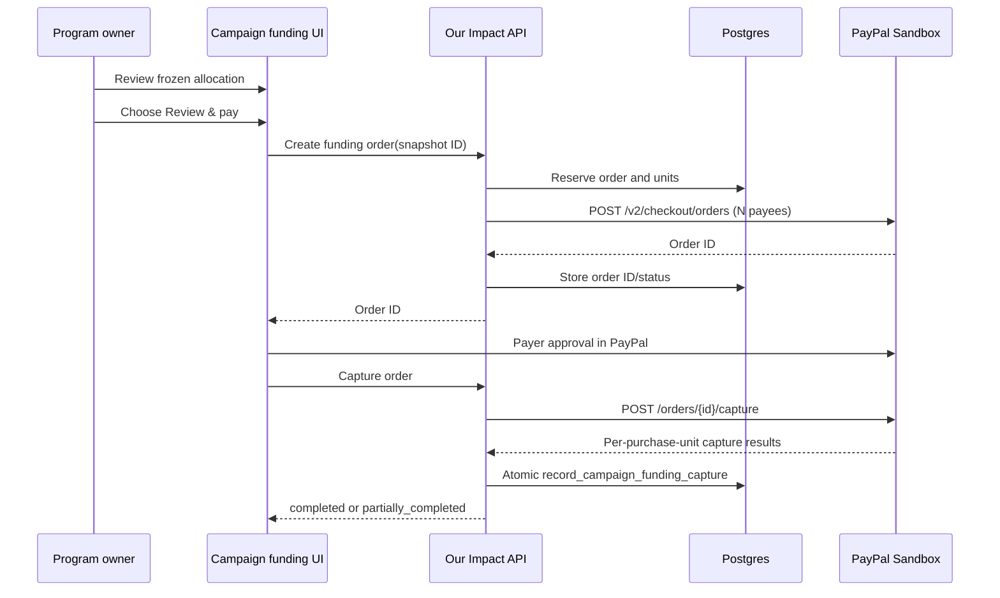

# PayPal Sandbox integration

This document is the implementation reference for PayPal in Our Impact. It describes the APIs called, headers used, state ownership, webhook behavior, and current sandbox limitations.

> [!WARNING]
> All PayPal code currently targets `https://api-m.sandbox.paypal.com`. There is no live base URL, live credential set, or environment switch. Do not treat sandbox completion as approval to operate a live charitable-payment platform.

## Current model

Our Impact is a platform integration, not a wallet:

- a recipient grants consent in PayPal and is represented by a PayPal merchant ID;
- a payer approves a PayPal order in PayPal's UI;
- Our Impact creates/captures the order and records verified results;
- Our Impact never receives the recipient's PayPal password, the payer's PayPal password, or card data.

There are two active Orders v2 flows:

| Flow | Payer | Payee | Product meaning |
| --- | --- | --- | --- |
| Direct supporter donation | The supporter | One connected recipient | Optional supporter-to-recipient contribution from the public widget. |
| Campaign funding | The program owner | One or more connected recipients | Explicit payment of a frozen campaign allocation. One purchase unit is created per recipient. |

The early Payouts API flow is retained only as historical sandbox evidence and is not the primary product.

## API inventory

| Purpose | Method and endpoint | Implementation |
| --- | --- | --- |
| OAuth access token | `POST /v1/oauth2/token` | `getPayPalSandboxAccessToken()` |
| Create seller referral | `POST /v2/customer/partner-referrals` | `createPayPalPartnerReferral()` |
| Check seller status | `GET /v1/customer/partners/{partner_id}/merchant-integrations/{merchant_id}` | `getPayPalMerchantIntegrationStatus()` |
| Create order | `POST /v2/checkout/orders` | direct and campaign funding create functions |
| Capture order | `POST /v2/checkout/orders/{order_id}/capture` | direct and campaign funding capture functions |
| Verify webhook | `POST /v1/notifications/verify-webhook-signature` | `verifyPayPalSandboxWebhook()` |
| Legacy create payout | `POST /v1/payments/payouts` | `createSandboxPayout()` |
| Legacy payout status | `GET /v1/payments/payouts/{batch_id}` | `getSandboxPayoutBatchDetails()` |

The server-side implementation lives in:

- `src/lib/paypal/sandbox.ts`: OAuth, webhook verification, and legacy Payouts;
- `src/lib/paypal/platform.ts`: partner onboarding and Orders v2;
- `src/lib/paypal/core.ts`: safe parsing, currency formatting, identifiers, and diagnostics;
- `src/app/api/paypal/onboarding/*`: recipient redirect/callback/status;
- `src/app/api/campaigns/[publicId]/donations/orders/*`: direct donations;
- `src/app/api/dashboard/campaigns/[id]/funding/orders/*`: program-owner funding;
- `src/app/api/webhooks/paypal/route.ts`: shared webhook listener.

## OAuth and platform headers

The server exchanges the sandbox client ID and client secret with:

```http
POST https://api-m.sandbox.paypal.com/v1/oauth2/token
Authorization: Basic base64(client_id:client_secret)
Content-Type: application/x-www-form-urlencoded

grant_type=client_credentials
```

Access tokens are cached in process memory until one minute before their reported expiry. Warm Vercel instances may reuse the token; a cold instance obtains a new one.

Platform calls include:

```http
Authorization: Bearer ACCESS_TOKEN
PayPal-Partner-Attribution-Id: BN_CODE
PayPal-Request-Id: IDEMPOTENCY_KEY
Content-Type: application/json
```

Third-party calls made on behalf of one recipient also include a `PayPal-Auth-Assertion`. Our Impact builds an unsigned assertion with the platform client ID as `iss` and the recipient merchant ID as `payer_id`, following PayPal's third-party request model.

`PayPal-Request-Id` values are stable for the reserved operation wherever possible. Database state claims and unique references provide the second layer of idempotency.

## Recipient onboarding

### Preconditions

Before PayPal is involved:

1. A program owner creates a recipient relationship and a private invitation.
2. The invitation link is signed with `DEVELOPER_SIGNING_SECRET`.
3. The representative requests a Supabase email OTP/magic link.
4. The authenticated email must exactly match the invitation's normalized contact email.
5. A database trigger claims the recipient membership and marks the invitation claimed.

The signed invitation identifies the proposed relationship; it does not replace email authentication.

### Referral request

When the authenticated representative chooses **Connect PayPal Sandbox**, Our Impact:

1. reserves/upserts `paypal_merchant_connections` with a random tracking ID;
2. calls Partner Referrals v2;
3. requests an `API_INTEGRATION` using:
   - `integration_method: PAYPAL`;
   - `integration_type: THIRD_PARTY`;
   - features `PAYMENT` and `REFUND`;
   - product `EXPRESS_CHECKOUT`;
   - `SHARE_DATA_CONSENT`;
4. stores the returned partner referral ID;
5. redirects the browser to PayPal's `action_url`.



### Callback and readiness

PayPal returns:

- `merchantId`, used as the referral tracking ID;
- `merchantIdInPayPal`, the recipient merchant ID;
- optional `consentStatus`.

The callback does not trust those query parameters as proof of readiness. It calls the merchant integration status endpoint and requires:

- at least one OAuth integration;
- `payments_receivable = true`;
- `primary_email_confirmed = true`;
- an active supported checkout product (`EXPRESS_CHECKOUT` or an accepted PPCP status).

Only then does Our Impact mark:

- connection `status = active`;
- `curation_state = approved`;
- invitation `status = accepted`;
- workspace-recipient relationship `active`.

Otherwise the connection remains `needs_attention` / `pending` with `merchant_setup_incomplete`. The recipient can use the refresh route after finishing setup.

### Why the program owner cannot connect for the recipient

Onboarding requires:

- possession of the invitation email;
- an authenticated recipient membership;
- the recipient's own PayPal login and consent.

The program owner sees readiness and can replace/revoke the relationship, but does not receive the merchant's credentials.

## Direct supporter donation

Direct checkout is available only when:

- the campaign is published;
- campaign currency is USD;
- the recipient belongs to that campaign;
- the recipient merchant connection is active and approved;
- the amount passes route validation;
- widget identity, if supplied, matches the campaign/company.

### Create

The widget calls:

```http
POST /api/campaigns/{publicId}/donations/orders
```

The server:

1. resolves the public campaign and recipient;
2. resolves anonymous or signed widget identity;
3. reserves a `donation_sessions` row with a public reference and request ID;
4. sends one Orders v2 purchase unit with:
   - `intent: CAPTURE`;
   - `reference_id` and `custom_id` set to the public reference;
   - `payee.merchant_id` set to the recipient;
   - USD amount formatted from integer minor units;
5. stores the PayPal order ID and provider status;
6. returns the order ID to the PayPal JavaScript SDK.

The browser loads PayPal's JavaScript SDK using the sandbox client ID and recipient merchant ID. PayPal renders the approval experience; Our Impact does not render or collect payment fields itself.

### Capture

After buyer approval, the widget calls:

```http
POST /api/campaigns/{publicId}/donations/orders/{orderId}/capture
```

The server claims the donation session, calls Orders capture using the recipient merchant assertion, extracts the first capture, and records:

- order status;
- capture ID;
- capture status;
- completion time or safe error state.

If an identified widget is attached to a developer project, a completed capture becomes a replay-safe `donation.completed` developer event with external event ID:

```text
paypal_capture:{capture_id}
```

The database evaluates entitlement rules. The response returns the current entitlement list, and queued developer webhooks are attempted.

If database persistence fails after PayPal responds, the API tells the caller not to assume failure and waits for the verified webhook. This avoids charging twice to repair an uncertain local state.

## Program-owner campaign funding

Campaign funding pays a frozen allocation. It is not a recurring or scheduled debit.

### Preconditions

- The caller has an authenticated workspace owner/admin session.
- The allocation snapshot belongs to the campaign.
- Recipient amounts are positive and ready.
- Every payable recipient has an active, approved merchant connection.
- Currency and totals are consistent.
- The snapshot has not already been funded.

`reserve_campaign_funding_order` atomically creates or returns a reservation. A compatibility path may record the former approval status automatically, but the payer still must approve the PayPal checkout.

### Multi-seller order

The application supports 1–10 purchase units, matching the code guard and PayPal's multi-seller limit. Each unit contains:

- a stable reference ID;
- one recipient merchant ID in `payee`;
- the exact allocated minor-unit amount;
- the campaign and recipient description.

The PayPal JavaScript SDK is loaded with `merchant-id=*` and a `data-merchant-id` list for the recipient merchants.



PayPal can return partial multi-seller completion. The parser records each purchase unit's capture ID and status. The route returns HTTP 207 with `partially_completed` when not every unit completed. Never flatten a partial result into a single success boolean.

### Payment state ownership

- The UI initiates and displays.
- The route validates access and orchestrates PayPal.
- Database functions reserve work and atomically translate provider evidence into funding/unit/donation status.
- Verified webhooks can complete or correct provider-driven state.
- A late event must not downgrade stronger terminal evidence.

## Webhook listener

Endpoint:

```text
POST /api/webhooks/paypal
```

### Verification steps

1. Reject content lengths over 1 MB.
2. Require:
   - `paypal-transmission-id`;
   - `paypal-transmission-time`;
   - `paypal-cert-url`;
   - `paypal-auth-algo`;
   - `paypal-transmission-sig`.
3. Read and retain the raw body.
4. POST the headers, configured webhook ID, and original event to PayPal's verification endpoint.
5. Continue only if PayPal returns `verification_status: SUCCESS`.
6. Parse and validate event identifiers.
7. Persist through a replay-safe database function.

Our Impact currently uses PayPal's postback verification method rather than local certificate verification. This introduces one PayPal API call per webhook but centralizes cryptographic verification at PayPal.

### Subscribed events

Active Orders/onboarding handling:

| Event | Effect |
| --- | --- |
| `PAYMENT.CAPTURE.COMPLETED` | Record direct donation or campaign funding completion; emit developer event for identified direct donation. |
| `PAYMENT.CAPTURE.DENIED` | Record a denied/failed capture without inventing completion. |
| `PAYMENT.CAPTURE.REFUNDED` | Preserve refund evidence and transition affected records conservatively. |
| `PAYMENT.CAPTURE.REVERSED` | Preserve reversal evidence and require/reach reconciliation state as appropriate. |
| `MERCHANT.ONBOARDING.COMPLETED` | Persist onboarding event and merchant identifiers/status evidence. |
| `MERCHANT.PARTNER-CONSENT.REVOKED` | Record that platform consent is no longer valid. |

Payout event names containing `PAYOUT` are routed through the historical Payouts parser.

Unknown valid PayPal event types receive an ignored response. Malformed or unverified input is rejected.

### Replay and privacy behavior

- PayPal event IDs are unique in the event tables.
- Raw bodies are represented by a SHA-256 payload hash plus a bounded event summary; diagnostic email addresses are redacted where parsed.
- Duplicate events return the existing/processed result rather than applying a second transition.
- Direct donation developer events use capture ID uniqueness, so the synchronous capture path and later webhook converge.

### Delivery expectations

PayPal expects a 2xx response. According to PayPal's current webhook documentation, a non-2xx response can be retried up to 25 times over three days. Our Impact intentionally returns a failure status when verified evidence cannot be persisted, allowing PayPal to retry rather than acknowledging data loss.

## Historical Payouts path

The legacy path sends one Payouts item to a recipient email and tracks:

- sender batch and item IDs;
- provider batch/item IDs;
- masked recipient reference;
- request payload hash;
- append-only provider event state;
- leased polling metadata.

Render calls `/api/cron/reconcile-paypal` every five minutes. The worker:

1. claims up to 10 due records with `FOR UPDATE SKIP LOCKED` and a lease;
2. reads `GET /v1/payments/payouts/{batch_id}`;
3. applies status-only reconciliation;
4. never creates or retries a payout.

Backoff:

- pending: 5 minutes;
- held: 30 minutes;
- unclaimed: 6 hours;
- missing status: 15 minutes;
- transient worker errors: 5, 15, then 60 minutes;
- terminal states: polling stops.

This worker does not reconcile current Orders v2 captures. Orders rely on synchronous capture results plus verified capture webhooks.

## Error handling

PayPal error responses are reduced to:

- normalized error code/name;
- PayPal debug ID;
- bounded `field` and `issue` details.

Email-like content in diagnostic fields is redacted. The application distinguishes:

- **rejected**: PayPal gave a negative result;
- **uncertain**: network/server behavior means the payment result may exist and must not be retried blindly.

The UI should preserve this distinction. “Try again” is unsafe after an uncertain capture unless provider state has been reconciled.

## Configuration and secret placement

| Variable | Meaning | Browser exposure |
| --- | --- | --- |
| `PAYPAL_SANDBOX_CLIENT_ID` | REST app ID; also passed to PayPal JS SDK | Visible through the SDK URL, which is expected |
| `PAYPAL_SANDBOX_CLIENT_SECRET` | OAuth client secret | Never |
| `PAYPAL_SANDBOX_WEBHOOK_ID` | Registered listener ID for signature verification | Never |
| `PAYPAL_SANDBOX_PARTNER_MERCHANT_ID` | Platform sandbox merchant ID | Never required by host browser |
| `PAYPAL_PARTNER_ATTRIBUTION_ID` | BN code | Sent in server-to-server headers |

All values are stored in Vercel. Render receives none of them.

## Going live: required redesign and validation

Moving from sandbox to live is not “replace the URL.” Before adding a live environment:

1. Obtain PayPal partner approval and live credentials for the actual business model and regions.
2. Confirm whether each recipient category is eligible and whether charity-specific products or PayPal Giving Fund requirements apply.
3. Define who is merchant of record, who issues receipts, and who owns refunds, disputes, tax reporting, and sanctions/KYC obligations.
4. Confirm multi-seller Orders limits, fee behavior, partial capture behavior, and currencies.
5. Add an explicit environment model in code and data; do not infer environment from a credential string.
6. Separate sandbox and live webhook IDs and event tables/records visibly.
7. Add live-specific operational alarms and reconciliation for Orders.
8. Complete a security review of secret storage, webhook verification, SSRF boundaries, and audit retention.
9. Make payer consent and every recurring/saved-payment mandate explicit.
10. Update product copy so an allocation, an approved order, and settled funds cannot be confused.

Automatic interval-based funding is not implemented. A cron expression is not payment authorization.

## Official references

- [PayPal REST authentication](https://developer.paypal.com/api/rest/authentication)
- [Making PayPal REST requests and third-party headers](https://developer.paypal.com/api/make-api-requests/)
- [Seller onboarding overview](https://developer.paypal.com/platforms/seller-onboarding)
- [Build seller onboarding](https://developer.paypal.com/docs/multiparty/seller-onboarding/build-onboarding/)
- [Orders v2 integration](https://developer.paypal.com/api/rest/integration/orders-api)
- [Multi-seller payments](https://developer.paypal.com/platforms/checkout/standard/customize/multiseller-payments)
- [Webhook overview](https://developer.paypal.com/api/rest/webhooks)
- [Webhook verification and retry behavior](https://developer.paypal.com/api/rest/webhooks/rest/)
- [PayPal developer security guidelines](https://developer.paypal.com/security-guidelines)
