# Publishing the Our Impact SDKs

This document is the release runbook. The API implementation remains in the
Next.js application; APIMatic consumes an exported OpenAPI contract and turns
the server-only portion into a distributable SDK. APIMatic does not host or
execute the Our Impact API.

Our Impact ships two public npm packages with different release paths:

- `@our-impact/node` is generated from `apimatic/server/src/spec/openapi.json` and is
  published through APIMatic. It is for trusted server code and accepts secret API keys.
- `@our-impact/browser` is hand-maintained in `packages/browser` and is published directly
  to npm. It accepts only a publishable key and a short-lived user identity token.

The separation is intentional. The browser package also owns the campaign embed and
automatic resizing behavior, which are not generated from the HTTP API description.

## One-time account setup

1. Create or claim the public `@our-impact` scope on npm and enable two-factor
   authentication for the account that owns it.
2. In APIMatic's **Publishing Center**, add an npm credential and create a publishing
   profile whose TypeScript package name is `@our-impact/node`.
3. Optionally attach a dedicated GitHub SDK repository to the same profile if generated
   source should also be public outside this monorepo.
4. Sign the local CLI in with `apimatic auth login`, then confirm the profile ID with
   `apimatic publishing profile list`.

The APIMatic CLI currently requires Node.js 24 or newer. Install the same major
version used during the initial release:

```bash
npm install --global @apimatic/cli@2
apimatic --version
apimatic auth login
```

Never commit npm tokens, APIMatic API keys, or Our Impact secret API keys.

## Release checks

First update the TypeScript-owned contract and export its generated snapshots:

```bash
pnpm openapi:export
pnpm sdk:check
apimatic api validate --input ./apimatic/server
```

`pnpm openapi:export` updates both the full documentation contract and the
server-SDK contract. Review the generated diffs. Do not hand-edit the snapshots
to make validation pass; change `src/lib/developer/openapi.ts` or the route
behavior and export again.

Before a release, also run:

```bash
pnpm test
pnpm lint
pnpm typecheck
pnpm build
```

Review the generated server SDK before publishing:

```bash
apimatic sdk publish \
  --dry-run \
  --profile-id=<profile-id> \
  --language=typescript \
  --version=0.1.0 \
  --publish-type=package \
  --input=./apimatic/server \
  --destination=./packages/node
```

## Publish the generated server SDK

Remove `--dry-run` after reviewing the package. Add a second
`--publish-type=sourcecode` flag if the publishing profile also has a GitHub repository.

```bash
apimatic sdk publish \
  --profile-id=<profile-id> \
  --language=typescript \
  --version=0.1.0 \
  --publish-type=package \
  --input=./apimatic/server \
  --destination=./packages/node
```

APIMatic generates, builds, and publishes this package to npm using the publishing
profile. Consumers can then install it with:

```bash
npm install @our-impact/node
```

## Publish the browser SDK

Build and inspect the hand-maintained browser tarball, then publish it directly from its
package directory:

```bash
npm --prefix packages/browser run build
npm pack --dry-run ./packages/browser
npm publish ./packages/browser
```

The package's `publishConfig.access` is `public`, so the initial scoped release is public.
Consumers can then install it with:

```bash
npm install @our-impact/browser
```

## Versioning

The packages are versioned independently:

- `@our-impact/node` is currently `0.1.0`;
- `@our-impact/browser` is currently `0.2.0`.

Every npm release requires a new semantic version; a published version cannot
be overwritten. Bump only the package whose public contract changed. Coordinated
releases may share a version, but equal versions are not an architectural
requirement.

For a server API change, update the Next.js route behavior and OpenAPI source together,
export the snapshots, regenerate the server SDK, run the smoke test, and publish both
packages only if the browser surface changed as well.

Use:

- a patch release for compatible fixes;
- a minor release for backward-compatible operations or options;
- a major release for removed/renamed operations, incompatible payloads, or
  changed authentication semantics.

While the packages remain pre-1.0, treat every minor version as potentially
breaking and state the change clearly in release notes.

## What APIMatic contributes

```mermaid
flowchart LR
  Routes["Next.js /api/v1 behavior"] --> Source["openapi.ts"]
  Source --> Export["pnpm openapi:export"]
  Export --> Spec["apimatic/server OpenAPI"]
  Spec --> Validate["APIMatic validation"]
  Validate --> Generate["TypeScript SDK generation"]
  Generate --> Package["@our-impact/node"]
  Package --> DryRun["Publishing-profile dry run"]
  DryRun --> Npm["npm registry"]
```



APIMatic contributes contract validation, generated models/controllers,
documentation artifacts, TypeScript packaging, and publishing-profile
automation. Our Impact still owns:

- the route implementation and authorization rules;
- the source OpenAPI generator;
- the package name, metadata, examples, and release decision;
- smoke tests against a mock server;
- the hand-written browser SDK.

If APIMatic displays a stale title such as “Swagger Petstore,” the publishing
project was created from the wrong or an old spec. Confirm the input is
`apimatic/server` and that its `src/spec/openapi.json` title is “Our Impact
Developer API” before publishing.

## Developer portal

The installable packages live on npm. Documentation is a separate concern:

- The product-facing documentation is served by the Next.js app at `/developers/docs`.
- The APIMatic portal can be previewed with `apimatic portal serve --input ./apimatic` or
  generated as a static site with `apimatic portal generate --input ./apimatic`.

Publishing an SDK does not automatically deploy the Next.js documentation site. The
Vercel deployment continues to publish that site from this repository.

## Official APIMatic references

- [Install the APIMatic CLI](https://docs.apimatic.io/v4/apimatic-cli/install/)
- [Generate an SDK with the CLI](https://docs.apimatic.io/v4/generate-sdks/create-sdk-cli/)
- [Publish SDKs](https://docs.apimatic.io/v4/generate-sdks/publish-sdks/)
